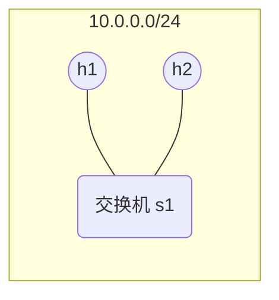
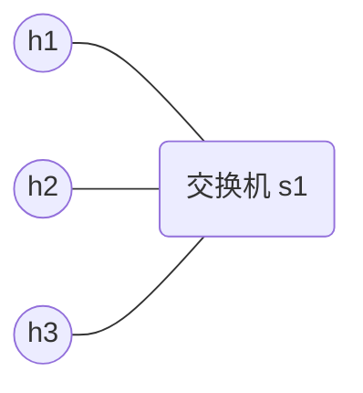
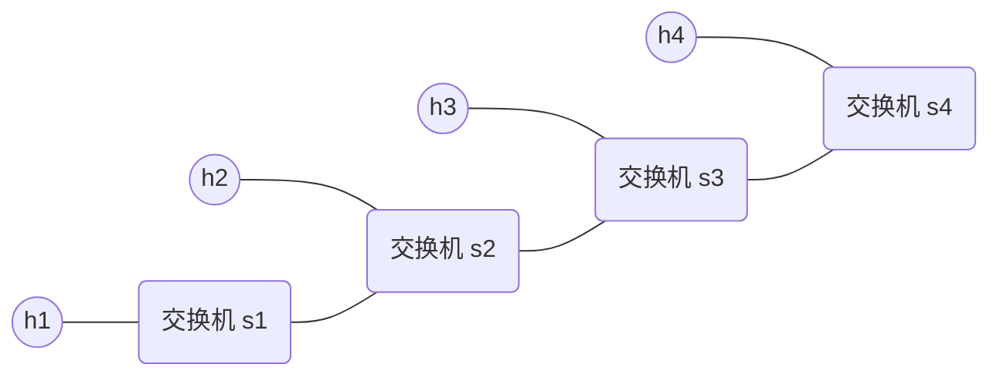
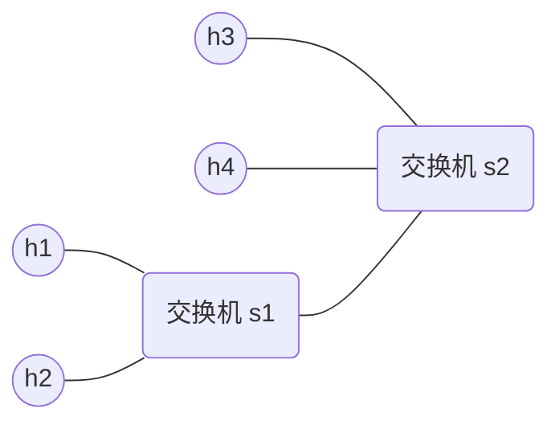

import { Aside } from 'astro-pure/user'

在前面的文章中我们一直在看理论（最近一篇是 [[sdn-03-openflow-protocol|OpenFlow 协议]]），今天终于要动手了。Mininet 是 SDN 领域最常用的网络仿真工具，它能在一台电脑上模拟出由多台交换机和主机组成的网络拓扑，用来做各种网络实验。

这篇文章会带你从零搭建 Mininet 环境，并完成一系列基础实验。

---

## 一、什么是 Mininet

Mininet 是一个轻量级的网络仿真工具，由斯坦福大学开发。它的核心能力是：

- 在一台普通电脑上创建虚拟的交换机、主机和链路
- 这些虚拟设备运行的是真实的 Linux 网络栈，不是模拟器
- 支持 OpenFlow 协议，可以连接真实的 SDN 控制器
- 用 Python 脚本就能定义任意网络拓扑

简单说，Mininet 就是一个"网络沙箱"，你可以在里面随意搭建、测试网络，不用担心影响真实网络。

### 1.1 Mininet 能做什么

| 用途     | 说明                                          |
| -------- | --------------------------------------------- |
| 快速原型 | 几分钟搭建一个复杂的网络拓扑进行测试          |
| SDN 实验 | 配合 Ryu/ONOS 等控制器验证 OpenFlow 功能      |
| 网络调试 | 用 Wireshark 抓包分析数据包在虚拟网络中的流转 |
| 教学演示 | 课堂上现场演示网络协议的行为                  |

### 1.2 安装环境

我们选择在 **WSL2 + Ubuntu 24.04** 上安装 Mininet，这也是目前最推荐的方式。原因：

- WSL2（Windows Subsystem for Linux，Windows Linux 子系统）内核支持网络命名空间，Mininet 需要这个功能
- Ubuntu 软件源丰富，依赖安装方便
- 不需要虚拟机，启动快、资源占用小

如果日常要管理多个 WSL 实例，可以配合 [[wsl-dashboard-guide|WSL Dashboard]] 这类图形化工具；环境还没搭好就先看 [[wsl2-setup-guide|WSL2 + Ubuntu 24.04 环境搭建]]。

---

## 二、安装 Mininet

在 WSL2 的 Ubuntu 终端中执行以下步骤。

<Aside type='tip' title='前置条件'>
  以下步骤需要一台已经装好基础环境（Git、Python 软链接、gcc/make、tcpdump）的 Ubuntu 24.04。
  如果还没准备，先看 [WSL2 + Ubuntu 24.04 环境搭建](/blog/devtools/wsl2-setup-guide)。
</Aside>

### 2.1 从源码安装

Mininet 官方推荐从 GitHub 源码安装，这样可以获取最新版本：

```bash
# 克隆源码
git clone https://github.com/mininet/mininet.git
cd mininet

# Ubuntu 24.04 兼容性修复
# 1. 安装 pycodestyle（替代旧版 pep8）
sudo apt install -y pycodestyle

# 2. 修改安装脚本中的包名
sudo sed -i 's/pep8/pycodestyle/g' util/install.sh

# 3. 安装 Mininet 及所有依赖
sudo ./util/install.sh -a
```

### 2.2 安装过程中的常见问题

| 问题                                         | 原因                           | 解决方法                          |
| -------------------------------------------- | ------------------------------ | --------------------------------- |
| `Unable to locate package mininet`           | Ubuntu 默认源没有 Mininet      | 从源码安装                        |
| `Package pep8 has no installation candidate` | Ubuntu 24.04 中 pep8 已改名    | `apt install pycodestyle`         |
| `externally-managed-environment`             | Ubuntu 24.04 禁止全局 pip 安装 | 安装 `python3-pip-whl`            |
| `Cannot find required executable mnexec`     | mnexec 未编译                  | `cd mininet && sudo make install` |
| `Cannot find required executable ovs-vsctl`  | Open vSwitch 未安装            | `apt install openvswitch-switch`  |

### 2.3 修复 mnexec

mnexec 是 Mininet 的核心执行工具，有时安装脚本不会自动编译它，需要手动处理：

```bash
cd ~/mininet   # Mininet 源码目录
sudo make
sudo make install
```

然后安装 Open vSwitch（Mininet 需要它作为虚拟交换机）：

```bash
sudo apt install -y openvswitch-switch openvswitch-common
```

### 2.4 验证安装

```bash
sudo mn --version
```

如果输出版本号（如 `2.3.1b4`），说明安装成功。

---

## 三、第一个实验：默认拓扑 pingall

Mininet 自带一个默认拓扑：1 台交换机 + 2 台主机。用 `--test pingall` 可以一键创建拓扑、启动、测试连通性，然后自动退出。

```bash
sudo mn --test pingall
```

执行结果：

```text
*** Creating network
*** Adding hosts: h1 h2
*** Adding switches: s1
*** Adding links: (h1, s1) (h2, s1)
*** Configuring hosts h1 h2
*** Starting controller
*** Starting 1 switches: s1 ...
*** Ping: testing ping reachability
h1 -> h2
h2 -> h1
*** Results: 0% dropped (2/2 received)
*** Done
completed in 0.247 seconds
```

### 3.1 解读输出

逐步拆解这个过程：

1. **创建网络** — Mininet 创建了虚拟的网络命名空间
2. **添加主机** — 创建了 h1 和 h2 两台虚拟主机，各自有独立的 IP 地址
3. **添加交换机** — 创建了 s1（默认使用 OVS（Open vSwitch，开源虚拟交换机） Bridge 模式）
4. **添加链路** — h1 连到 s1，h2 连到 s1
5. **配置主机** — 给 h1（10.0.0.1）和 h2（10.0.0.2）分配 IP
6. **Ping 测试** — h1 ping h2，h2 ping h1，全部成功
7. **0% dropped** — 没有丢包，网络连通性正常

### 3.2 网络拓扑图

这个实验的拓扑非常简单：



两台主机通过同一台交换机互联，相当于两台电脑连在同一个交换机上。

---

## 四、指定拓扑实验

Mininet 内置了几种常见拓扑，通过 `--topo` 参数指定。

### 4.1 Single 拓扑：1 台交换机 + N 台主机

```bash
sudo mn --topo single,3 --test pingall
```

结果：

```text
*** Adding hosts: h1 h2 h3
*** Adding switches: s1
*** Ping: testing ping reachability
h1 -> h2 h3
h2 -> h1 h3
h3 -> h1 h2
*** Results: 0% dropped (6/6 received)
```

拓扑图：



3 台主机两两互通，总共 6 次 ping（h1→h2、h1→h3、h2→h1、h2→h3、h3→h1、h3→h2），全部成功。

### 4.2 Linear 拓扑：N 台交换机串联

```bash
sudo mn --topo linear,4 --test pingall
```

结果：

```text
*** Adding hosts: h1 h2 h3 h4
*** Adding switches: s1 s2 s3 s4
*** Adding links: (h1,s1) (h2,s2) (h3,s3) (h4,s4) (s2,s1) (s3,s2) (s4,s3)
*** Ping: testing ping reachability
h1 -> h2 h3 h4
h2 -> h1 h3 h4
h3 -> h1 h2 h4
h4 -> h1 h2 h3
*** Results: 0% dropped (12/12 received)
completed in 0.615 seconds
```

拓扑图：



4 台交换机串联成一条线，每台交换机下挂一台主机。注意完成时间从 0.247 秒增加到了 0.615 秒，因为交换机之间的转发路径变长了。

---

## 五、交互式操作

除了命令行一键测试，Mininet 还提供了一个交互式 CLI，可以手动操作每个节点。

### 5.1 启动 Mininet

```bash
sudo mn
```

启动后进入 Mininet 命令行：

```text
mininet>
```

### 5.2 查看节点和拓扑

```bash
mininet> nodes
available nodes are:
h1 h2 s1

mininet> net
h1 h1-eth0:s1-eth1
h2 h2-eth0:s1-eth2
s1 lo:  s1-eth1:h1-eth0 s1-eth2:h2-eth0
```

`nodes` 列出所有节点，`net` 显示每个节点的接口和连接关系。

### 5.3 手动 Ping 测试

```bash
mininet> h1 ping h2
PING 10.0.0.2 (10.0.0.2) 56(84) bytes of data.
64 bytes from 10.0.0.2: icmp_seq=1 ttl=64 time=1.52 ms
64 bytes from 10.0.0.2: icmp_seq=2 ttl=64 time=0.114 ms
64 bytes from 10.0.0.2: icmp_seq=3 ttl=64 time=0.121 ms
...
```

`h1 ping h2` 表示在 h1 上执行 ping 命令。按 `Ctrl + C` 停止。

可以看到第一个包的延迟是 1.52ms（因为要查 ARP 表），后面稳定在 0.1ms 左右，说明虚拟网络的延迟非常低。

### 5.4 带宽测试

```bash
mininet> iperf
*** Iperf: testing TCP bandwidth between h1 and h2
*** Results: ['91.8 Gbits/sec', '91.6 Gbits/sec']
```

iperf 测试 h1 到 h2 的 TCP 带宽。结果显示 91.8 Gbits/sec，这是因为虚拟网络走的是内存，带宽远超物理网络。

### 5.5 自定义拓扑实验

Mininet 内置的拓扑有限，我们可以用 Python 脚本定义任意拓扑。下面是一个 2 交换机 + 4 主机的例子。

创建文件 `topo.py`：

```python
from mininet.net import Mininet
from mininet.topo import Topo

class MyTopo(Topo):
    def build(self):
        h1 = self.addHost('h1')
        h2 = self.addHost('h2')
        h3 = self.addHost('h3')
        h4 = self.addHost('h4')
        s1 = self.addSwitch('s1')
        s2 = self.addSwitch('s2')

        self.addLink(h1, s1)
        self.addLink(h2, s1)
        self.addLink(h3, s2)
        self.addLink(h4, s2)
        self.addLink(s1, s2)

topos = { 'mytopo': ( lambda: MyTopo() ) }
```

拓扑图：



运行：

```bash
sudo mn --custom topo.py --topo mytopo --test pingall
```

结果：

```text
*** Ping: testing ping reachability
h1 -> h2 h3 h4
h2 -> h1 h3 h4
h3 -> h1 h2 h4
h4 -> h1 h2 h3
*** Results: 0% dropped (12/12 received)
```

两台交换机之间有链路连接，h1/h2 通过 s1 通信，h3/h4 通过 s2 通信，跨交换机的流量经过 s1-s2 链路转发。

### 5.6 tcpdump 抓包

Mininet 的主机可以运行 `tcpdump` 来抓取经过网卡的数据包（前面基础环境已安装）。启动自定义拓扑进入交互模式：

```bash
sudo mn --custom topo.py --topo mytopo
```

在 h1 上启动抓包（后台运行），然后让 h1 ping h2：

```bash
mininet> h1 tcpdump -i h1-eth0 -c 5 &
mininet> h1 ping -c 3 h2
```

输出：

```text
tcpdump: listening on h1-eth0, link-type EN10MB (Ethernet), snapshot length 262144 bytes
11:33:59.283728 IP6 fe80::b838:87ff:fee5:35ad > ip6-allrouters: ICMP6, router solicitation, length 16
PING 10.0.0.2 (10.0.0.2) 56(84) bytes of data.
64 bytes from 10.0.0.2: icmp_seq=1 ttl=64 time=2.07 ms
64 bytes from 10.0.0.2: icmp_seq=2 ttl=64 time=0.121 ms
64 bytes from 10.0.0.2: icmp_seq=3 ttl=64 time=0.111 ms
```

tcpdump 抓到了 IPv6 路由请求包（ICMP6 router solicitation），这是主机启动时自动发送的。如果想只抓 IPv4 的 ICMP 包，可以用过滤器：

```bash
mininet> h1 tcpdump -i h1-eth0 -c 5 icmp &
mininet> h1 ping -c 3 h2
```

`-c 5` 表示抓够 5 个包后自动停止，`&` 让它在后台运行。

### 5.7 退出

```bash
mininet> quit
```

---

## 六、常用命令速查

| 命令                                     | 作用                       |
| ---------------------------------------- | -------------------------- |
| `sudo mn`                                | 启动默认拓扑并进入交互模式 |
| `sudo mn --test pingall`                 | 一键测试连通性             |
| `sudo mn --topo single,3`                | 指定 1 交换机 + 3 主机     |
| `sudo mn --topo linear,4`                | 指定 4 交换机线性拓扑      |
| `sudo mn --custom topo.py --topo mytopo` | 使用自定义拓扑             |
| `nodes`                                  | 查看所有节点               |
| `net`                                    | 查看网络连接               |
| `h1 ping h2`                             | 在 h1 上 ping h2           |
| `iperf`                                  | TCP 带宽测试               |
| `h1 tcpdump -i h1-eth0 -c 5 &`           | 在 h1 上后台抓包           |
| `exit` / `quit`                          | 退出 Mininet               |
| `sudo mn -c`                             | 清理残留的 Mininet 进程    |

---

## 七、本章小结

| 项目       | 内容                                                       |
| ---------- | ---------------------------------------------------------- |
| 环境搭建   | WSL2 + Ubuntu 24.04 + Mininet 2.3.1 + OVS                  |
| 基础实验   | default pingall、single-3 pingall、linear-4 pingall        |
| 交互操作   | nodes、net、h1 ping h2、iperf                              |
| 核心收获   | 理解 Mininet 的工作原理，能够独立搭建虚拟网络并进行测试    |
| 遇到的问题 | Ubuntu 24.04 的 pep8 包改名、python 软链接缺失、OVS 未安装 |
| 待深入     | 安装 Ryu 控制器，实现第一个 SDN 实验（L2 Switch），再进入 [[sdn-05-intrusion-detection|SDN 安全与入侵检测]] |

---

## 参考资料

1. [Mininet Book](https://yeasy.gitbook.io/mininet_book/) — Mininet 官方中文教程
2. [Mininet GitHub](https://github.com/mininet/mininet) — 源码与安装指南
3. [SDNLAB Mininet 教程](http://www.sdnlab.com/sdn-guide/) — SDN 实验入门
4. [Mininet 官方文档](https://mininet.org/) — API 参考与示例
